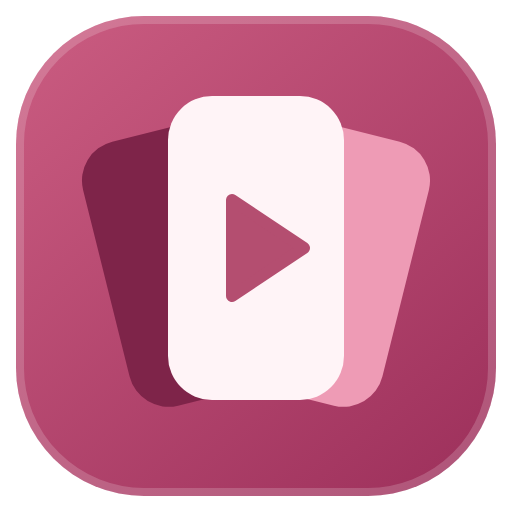

  

<h1 align="center">Shorts Trend Finder</h1>

  A Windows app for finding high-performing YouTube Shorts in any niche, using live data from the official YouTube Data API v3.

  <a href="https://github.com/Hamadullah123/ShortsTrendFinder-Releases/releases/latest"><b>⬇ Download the latest version</b></a>

---

## Features

The app has three sections: **Discover**, **Library** and **Settings**.

- **Discover:** search by keyword and browse niches in one place.
  - Find the top Shorts whose *title* contains your keyword, using Exact phrase, All keywords or Any keyword matching.
  - Open **Niches** to browse 10 categories (Gaming, Technology, Finance & Business…), each with sub-niches you can customise. Official YouTube categories are labelled separately from the app's own presets.
  - Click the search bar to see your recent searches, or open **History** for the full list.
- **Filters:** last 24 hours, 7 days, 30 days or custom dates; Most viewed or Trending candidates; minimum views; duration range; language and region.
- **Library:** bookmark Shorts, organise them into collections and add your own notes, with your saved searches in a second tab so you can rerun them in one click.
- **Usage:** a quota tracker in the sidebar, plus a daily chart in **Settings → Usage** of the search requests and API units you've used.

## Install

1. Download **Shorts-Trend-Finder-Setup-x.y.z.exe** from the [latest release](https://github.com/Hamadullah123/ShortsTrendFinder-Releases/releases/latest).
2. Run it. The installer isn't code-signed, so if Windows SmartScreen appears, click **More info → Run anyway**.
3. To upgrade, just install the new version over the old one. Your settings, key and library are kept.

## You need your own free YouTube API key

No API key is included, and API keys must not be shared. To create one:

1. In [Google Cloud Console](https://console.cloud.google.com/apis/library/youtube.googleapis.com), create a project and enable **YouTube Data API v3**.
2. Go to **APIs & Services → Credentials → Create credentials → API key**, and restrict the key to *YouTube Data API v3*.
3. Paste the key into the app's **Settings**. It's stored on your PC only, encrypted by Windows.

It's free: Google gives each project about 100 searches a day.

## Notes

- All data comes live from YouTube. Results are a sample from YouTube's search index and may not include every matching video.
- **Trending candidates** is YouTube's own relevance order and is labelled as an approximation. The app calculates no views-per-hour or growth scores.
- The app doesn't download YouTube videos.
- By using the app you agree to the [YouTube Terms of Service](https://www.youtube.com/t/terms). See also the [Google Privacy Policy](https://policies.google.com/privacy).

## License

Copyright © 2026 Hamad. All rights reserved. The software is proprietary. You may download and use the official builds, but not copy, modify or redistribute them. See [LICENSE](LICENSE).

YouTube is a trademark of Google LLC. This app is not affiliated with or endorsed by Google or YouTube.
